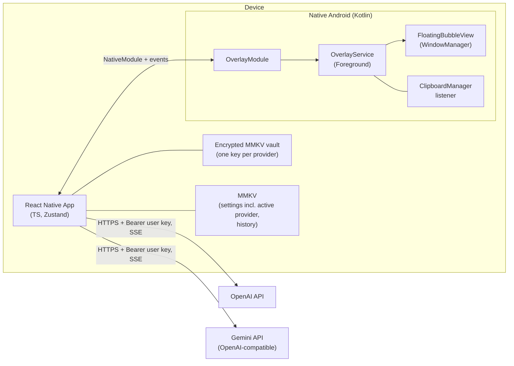
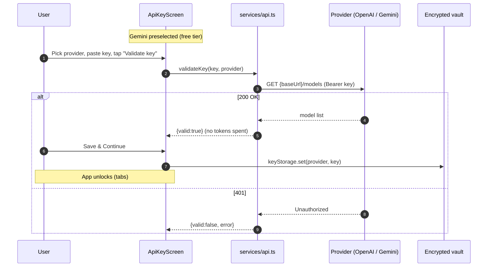
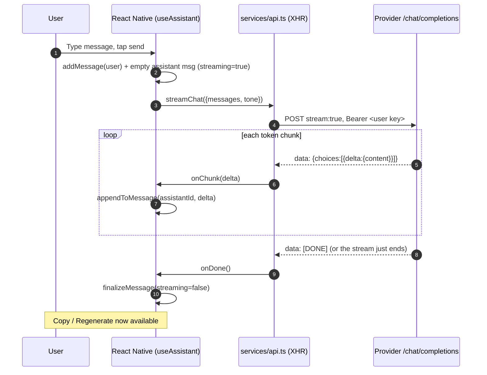
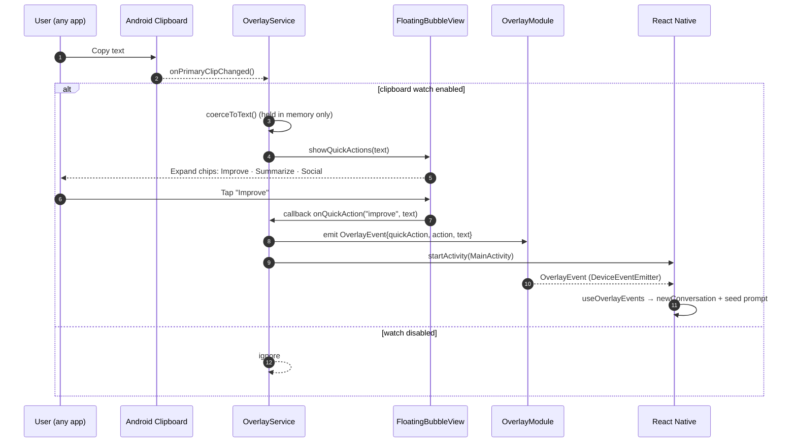
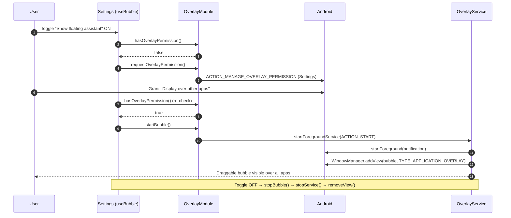

# Architecture & Sequence Diagrams

Diagrams use [Mermaid](https://mermaid.js.org) and render on GitHub. They cover
the flows that cross the app ↔ native ↔ LLM-provider boundaries. The app uses
**BYOK**: it calls the user's chosen provider (**OpenAI** or **Google Gemini**)
directly with the user's own key — there is no backend.

Gemini is reached through its OpenAI-compatible endpoint
(`generativelanguage.googleapis.com/v1beta/openai`), so both providers use the
same `/models` and `/chat/completions` protocol and one client
(`services/api.ts`) serves both. The diagrams below label that endpoint
"Provider"; only the base URL, model, and key change between providers
(`PROVIDERS` in `src/config.ts`).

## Components

Only the **active** provider is called. Its key is read from the encrypted
vault and attached as a Bearer token; a key never leaves the device except in
requests to the provider it belongs to.

`api.ts` doesn't import the stores (that would be a circular import). Instead,
`App.tsx` calls `registerProviderContext()` at startup, and the client reads
the active provider and key through that getter on every request.

---

## 0. First-launch key gate

The key's format is never checked locally. Providers change key formats
(Gemini moved from `AIza…` to `AQ.…`), so only the `/models` response decides.

**Switching provider** (Settings → AI provider) calls
`apiKeyStore.switchProvider(id)`. It saves the new provider in settings and
loads that provider's key from the vault. If a key is stored, the app stays
unlocked. If not, `status` becomes `no-key` and `RootNavigator` shows
`ApiKeyScreen` again.

---

## 1. Streaming AI response (chat / improve)

Token-by-token streaming over Server-Sent Events, straight from the active
provider. Both providers send OpenAI-shaped frames.

- **No `[DONE]` from Gemini:** Gemini's compat layer doesn't always send the
  `[DONE]` sentinel, so `xhr.onload` also calls `onDone` if the stream closes
  without one.
- **Retries:** a 500/502/503/504 response is retried up to 3 attempts with
  exponential backoff and jitter. The Gemini free tier returns 503 often. A
  stream is retried only if it failed **before** any token was shown;
  otherwise the retry would duplicate text. Non-streaming calls
  (`complete()`) use the same retry policy.

**Regenerate** clears the assistant message content and replays the same
history (`useAssistant.regenerate` → another `streamChat` call).

---

## 2. Clipboard quick-action

Event-driven (no polling). Copied text is used transiently and never persisted
by the native layer.

---

## 3. Floating bubble lifecycle & overlay permission

---

## Data & secret boundaries

| Data | Where it lives | Notes |
| --- | --- | --- |
| OpenAI / Gemini API keys (user's own) | Encrypted MMKV vault on-device, one entry per provider (`<provider>_api_key`) | `keyStorage.ts`; each sent only to its own provider (`api.openai.com` / `generativelanguage.googleapis.com`) |
| Settings (incl. active provider) & chat history | Encrypted MMKV | `storage.ts` |
| Clipboard text | RAM only (native) | Never written to disk |
